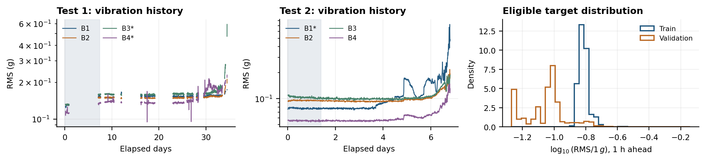

# Keep Learning or Start Over?

**Plasticity-Preserving Updates for Bearing Vibration Forecasting**  
Introduction to Machine Learning · American University of Beirut · Fall 2026

| Team member | Email |
|---|---|
| Elissa Ephrem | eee19@mail.aub.edu |
| Galia Akl | gra16@mail.aub.edu |
| Karim Bteish | krb05@mail.aub.edu |

## Research question

Do simple plasticity interventions improve one-hour-ahead vibration forecasting
relative to ordinary continual updates and periodic retraining at comparable
computational cost? A secondary analysis examines whether internal network
diagnostics predict the subsequent benefit of an intervention.

Our [proposal](paper/main.pdf) describes the study. So far, we have checked the
feature tables, run persistence, ridge, and static MLP baselines, and replayed
Test 2 with the MLP's weights fixed. The planned comparison covers ordinary
updating, periodic retraining, shrink-and-perturb, and selective resets.

## Reproduced results

We predict log10(RMS / 1 g) one hour ahead. Test 1 gives us 6,428 training
examples and Test 2 gives us 3,104 validation examples. Tests 1–3 are the original
IMS experiments, each with four bearings measured together.

| Model | Training MAE | Validation MAE | Validation RMSE | Validation late MAE |
|---|---:|---:|---:|---:|
| Last-value persistence | 0.003786 | 0.011278 | 0.025189 | 0.069358 |
| Moving-average persistence | 0.003362 | 0.011243 | 0.026222 | 0.076993 |
| Ridge residual | 0.003380 | 0.011151 | 0.025666 | 0.075942 |
| Static MLP, seed 42 | 0.003361 | 0.011101 | 0.025853 | 0.076161 |

We reproduced these metrics on a laptop. We used Test 2 to select the ridge
penalty and neural checkpoint, so these are development results. The MLP has the
lowest overall MAE in this seed-42 run. Last-value persistence has the lowest
RMSE and late-life MAE. These results do not establish statistical superiority
or plasticity loss. We define late life as the final 10% of elapsed live-run time
for bearings with documented terminal failures.



B1–B4 identify the four bearings. Curve gaps mark irregular acquisition intervals.
Forecast pairs crossing those intervals are excluded. The histogram contains
targets retained after calibration, history, and forecast-horizon filtering.

## Reproducibility

We use Python 3.12 and the versions listed in `requirements.txt`. No GPU is
required. Run these commands from the repository root. Outputs go into
`runs/local/`, leaving the reference results unchanged.

### Windows PowerShell

```powershell
py -3.12 -m venv .venv
.\.venv\Scripts\python.exe -m pip install -r requirements.txt
$env:OPENBLAS_NUM_THREADS = "1"
.\.venv\Scripts\python.exe code\fetch_features.py --runs 1 2
.\.venv\Scripts\python.exe code\baseline.py --data-dir data --out runs\local
.\.venv\Scripts\python.exe code\static_mlp.py --data-dir data --out runs\local\results\static_mlp
.\.venv\Scripts\python.exe scripts\check_reproduction.py --run-root runs\local
```

If `py -3.12` cannot find your installation, check `python --version` and use
`python -m venv .venv` when it reports Python 3.12.

### macOS / Linux

```bash
python3.12 -m venv .venv
.venv/bin/python -m pip install -r requirements.txt
export OPENBLAS_NUM_THREADS=1
.venv/bin/python code/fetch_features.py --runs 1 2
.venv/bin/python code/baseline.py --data-dir data --out runs/local
.venv/bin/python code/static_mlp.py --data-dir data --out runs/local/results/static_mlp
.venv/bin/python scripts/check_reproduction.py --run-root runs/local
```

The downloader retrieves processed feature tables from a pinned third-party
repository and verifies SHA-256 checksums. These commands retrieve only Tests 1
and 2. Without `--runs`, it retrieves all six tables (approximately 13.5 MB).
Matching local files are reused. The `--destination` argument selects another data
directory. Original NASA/IMS waveforms are not downloaded or independently
processed by this script.

The baseline scripts load and score only Tests 1 and 2. Model checkpoints and
per-example predictions are regenerated locally and excluded from Git. The
reproduction check compares fresh metrics against the committed reference values
within an absolute tolerance of 1e-6. GitHub Actions runs the baselines, gradient
check, and frozen replay verification, including the synthetic tests.

### Frozen Test 2 replay

With an existing static checkpoint and feature tables, run from the repository root:

```powershell
.\.venv\Scripts\python.exe code\online_replay.py --data-dir data --checkpoint runs\local\results\static_mlp\model.npz --reference-predictions runs\local\results\static_mlp\test2_predictions.csv
```

Use your existing Python environment and substitute the paths to your saved files.
The replay loads only Test 2 and never retrains the checkpoint. Each bearing is
processed chronologically with a separate frozen model copy, the saved feature
order and residual scale, and fixed first-200-observation calibration from the
existing preprocessing. Future targets and late-life flags are kept outside the
prediction inputs and joined only after all predictions are recorded.

Outputs default to `runs/local/results/online_replay/`: `test2_predictions.csv`
contains input `time`, `target_time`, prediction `mlp`, observed target `y`, and
pair identifiers; `metrics.csv` and `metadata.json` record scores and checks.
`--out` must stay under this repository's `runs/` and separate from the saved
static results. Row-by-row predictions are checked against batch inference at
1e-12 absolute tolerance; `--reference-predictions` additionally checks pair
alignment, targets, and predictions against the saved CSV. The reference
checkpoint should reproduce validation MAE approximately 0.011101.

This replay uses the static rules to select valid pairs and remove shutdown
observations before prediction. It is an offline check of the frozen model.
Test 2 was used for checkpoint selection, so its score remains a development
result. Test 3 is not loaded or scored.

Our [replay checklist](docs/replay-checklist.md) covers forecasts, metrics, fixed
weights, and synthetic tests of the draft event log. Results are recorded in
[`results/replay_verification/summary.json`](results/replay_verification/summary.json).
Waiting for delayed-label replay to be completed so we can check it.

## Method and evaluation

Persistence predicts either the most recent log-RMS or its six-observation
trailing mean. Ridge and the MLP predict a correction to that trailing mean.
We use 20 transformed features and their trailing means, giving 40 inputs.
The first 200 observations of each bearing set its feature scaling and are
excluded from fitting and scoring. Forecast pairs stay within a regular
acquisition segment and have an elapsed horizon of 60 ± 1 minutes.

The MLP has architecture 40–64–64–1 with 6,849 parameters. Forward propagation,
backpropagation, and Adam are implemented with NumPy. A finite-difference check
runs before training. Test 2 selected epoch 1; early stopping ended at epoch 26.
Test 3 is reserved for evaluation after settings are frozen. Its descriptive
statistics have already been inspected, which limits claims of blind evaluation.

Detailed [data documentation](data_docs/README.md), the
[study protocol](docs/protocol.md), [static model description](docs/static-mlp.md),
and [experiment log](docs/experiment-log.md) accompany the results.

## Repository structure

| Path | Contents |
|---|---|
| `code/` | Feature-table downloader, persistence/ridge baseline, static MLP, frozen replay |
| `data_docs/` | Data provenance, feature definitions, checksum manifest |
| `results/` | Reference metrics, environment metadata, and plots |
| `runs/` | Ignored local experiment outputs |
| `paper/` | Proposal PDF, LaTeX source, BibTeX references, and figures |
| `docs/` | Protocol, experiment log, and model description |
| `scripts/` | Reproduction and replay checks |
| `.github/workflows/` | Automated baseline reproduction |


## Attribution

Original IMS data were collected by the University of Cincinnati's Center for
Intelligent Maintenance Systems with Rexnord and distributed through NASA.
Processed tables are from
[fatemeh-studio/nasa-bearing-anomaly](https://github.com/fatemeh-studio/nasa-bearing-anomaly),
pinned to commit `f8a40f9ec0b47aac027e69f631c1deb79c7bef66`.
Dataset, method, and software references appear in [paper/refs.bib](paper/refs.bib).

We used Claude for the initial draft and ChatGPT for help with code,
documentation, and the proposal. A team member reproduced the static baseline
metrics locally. See [ATTRIBUTION.md](ATTRIBUTION.md) for details.
