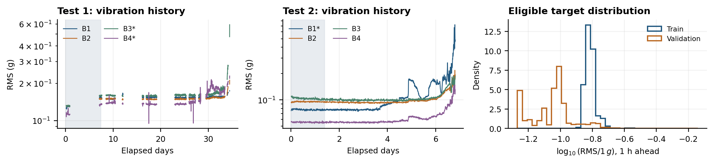

# Keep Learning or Start Over?

**Plasticity-Preserving Updates for Bearing Vibration Forecasting**  
Introduction to Machine Learning · American University of Beirut · Fall 2026

| Team member | Email |
|---|---|
| Elissa Ephrem | eee19@mail.aub.edu |
| Galia Akkl | gra16@mail.aub.edu |
| Karim Bteish | krb05@mail.aub.edu |

## Research question

Do simple plasticity interventions improve one-hour-ahead vibration forecasting
relative to ordinary continual updates and periodic retraining at comparable
computational cost? A secondary analysis examines whether internal network
diagnostics predict the subsequent benefit of an intervention.

The [proposal](paper/main.pdf) defines the study. The repository currently contains
verified feature-table access, exploratory analysis, persistence and ridge
baselines, and a from-scratch static NumPy neural network. Continual updating,
periodic retraining, shrink-and-perturb, and selective resetting form the planned
experimental comparison.

## Reproduced results

The target is log10(RMS / 1 g) one hour ahead. IMS Test 1 supplies 6,428 training
examples; Test 2 supplies 3,104 validation examples. These are original experimental
run names. Four bearings were measured together in each run.

| Model | Training MAE | Validation MAE | Validation RMSE | Validation late MAE |
|---|---:|---:|---:|---:|
| Last-value persistence | 0.003786 | 0.011278 | 0.025189 | 0.069358 |
| Moving-average persistence | 0.003362 | 0.011243 | 0.026222 | 0.076993 |
| Ridge residual | 0.003380 | 0.011151 | 0.025666 | 0.075942 |
| Static MLP, seed 42 | 0.003361 | 0.011101 | 0.025853 | 0.076161 |

These metrics were reproduced on a team member's Windows laptop. Test 2 selected
the ridge penalty and neural checkpoint, so the scores describe development
performance. The MLP has the lowest aggregate MAE in this single-seed experiment;
ridge has lower RMSE and last-value persistence has the lowest late-life MAE.
The comparison does not establish statistical superiority or plasticity loss.
Late-life evaluation covers the final 10% of elapsed live-run time for bearings
with documented terminal failures.



B1–B4 identify the four bearings. Curve gaps mark irregular acquisition intervals.
Forecast pairs crossing those intervals are excluded. The histogram contains
targets retained after calibration, history, and forecast-horizon filtering.

## Reproducibility

The implementation uses Python 3.12 and the packages pinned in `requirements.txt`.
No GPU is required. The commands below execute from the repository root and
preserve the committed reference results by writing into `runs/local/`.

### Windows PowerShell

```powershell
py -3.12 -m venv .venv
.\.venv\Scripts\python.exe -m pip install -r requirements.txt
$env:OPENBLAS_NUM_THREADS = "1"
.\.venv\Scripts\python.exe code\fetch_features.py
.\.venv\Scripts\python.exe code\baseline.py --data-dir data --out runs\local
.\.venv\Scripts\python.exe code\static_mlp.py --data-dir data --out runs\local\results\static_mlp
.\.venv\Scripts\python.exe scripts\check_reproduction.py --run-root runs\local
```

### macOS / Linux

```bash
python3.12 -m venv .venv
.venv/bin/python -m pip install -r requirements.txt
export OPENBLAS_NUM_THREADS=1
.venv/bin/python code/fetch_features.py
.venv/bin/python code/baseline.py --data-dir data --out runs/local
.venv/bin/python code/static_mlp.py --data-dir data --out runs/local/results/static_mlp
.venv/bin/python scripts/check_reproduction.py --run-root runs/local
```

The downloader retrieves approximately 13.5 MB of processed feature tables from a
pinned third-party repository and verifies SHA-256 checksums. Matching local files
are reused. The `--destination` argument selects another data directory. Original
NASA/IMS waveforms are not downloaded or independently processed by this script.

The baseline scripts load and score only Tests 1 and 2. Model checkpoints and
per-example predictions are regenerated locally and excluded from Git. The
reproduction check compares fresh metrics against the committed reference values
within an absolute tolerance of 1e-6. The included GitHub Actions workflow executes
the same download, baseline, gradient, and reproduction checks.

## Method and evaluation

Persistence predicts either the most recent log-RMS or its six-observation
trailing mean. Ridge and the MLP predict a correction to that trailing mean.
Forty inputs comprise 20 transformed features and their causal rolling means.
Each bearing's first 200 observations calibrate fixed transforms and are excluded
from fitting and scoring. Eligible pairs remain within a regular acquisition
segment and have an elapsed forecast horizon of 60 ± 1 minutes.

The MLP has architecture 40–64–64–1 with 6,849 parameters. Forward propagation,
backpropagation, and Adam are implemented with NumPy. A finite-difference check
runs before training. Test 2 selected epoch 1; early stopping ended at epoch 26.
Test 3 is reserved for evaluation after settings are frozen. Its descriptive
statistics have already been inspected, which limits claims of blind evaluation.

Detailed [data documentation](data_docs/README.md), the
[study protocol](docs/protocol.md), [static model description](docs/static-mlp.md),
and [experiment log](docs/experiment-log.md) accompany the results.

## Repository structure

| Path | Contents |
|---|---|
| `code/` | Feature-table downloader, persistence/ridge baseline, static MLP |
| `data_docs/` | Data provenance, feature definitions, checksum manifest |
| `results/` | Reference metrics, environment metadata, and plots |
| `runs/` | Ignored local experiment outputs |
| `paper/` | Proposal PDF, LaTeX source, BibTeX references, and figures |
| `docs/` | Protocol, experiment log, model description, and timeline |
| `scripts/` | Numerical reproduction check |
| `.github/workflows/` | Automated baseline reproduction |

## Proposal build

The `paper/` directory is a self-contained LaTeX project with `main.tex` as its
entry point and pdfLaTeX/BibTeX as its build tools. A local TeX Live installation
with `latexmk` supports the following build:

```bash
cd paper
latexmk -pdf main.tex
```

The compiled proposal contains three body pages plus references. Project milestones
and responsibilities are recorded in the [timeline](docs/roadmap.md).

## Attribution

Original IMS data were collected by the University of Cincinnati's Center for
Intelligent Maintenance Systems with Rexnord and distributed through NASA.
Processed tables are from
[fatemeh-studio/nasa-bearing-anomaly](https://github.com/fatemeh-studio/nasa-bearing-anomaly),
pinned to commit `f8a40f9ec0b47aac027e69f631c1deb79c7bef66`.
Dataset, method, and software references appear in [paper/refs.bib](paper/refs.bib).

Claude was used for an initial project draft. ChatGPT assisted with the revised
protocol, source review, code, documentation, and proposal preparation. The
reported static baseline metrics were reproduced locally by a team member.
[ATTRIBUTION.md](ATTRIBUTION.md) records this assistance and the source provenance.
