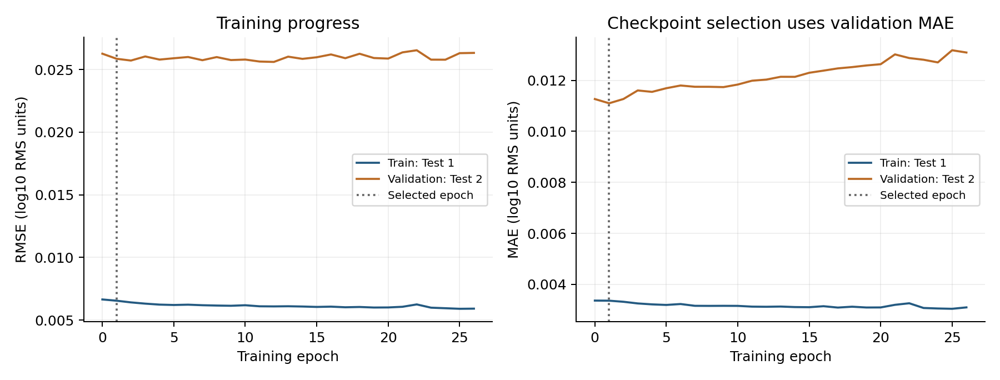
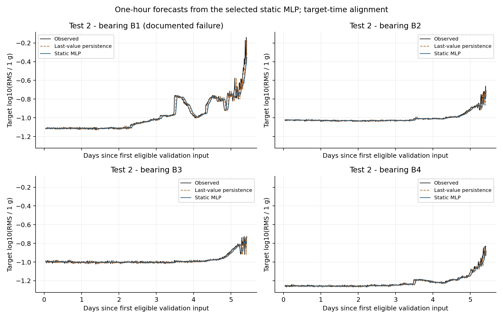

# Static MLP reference experiment

The model predicts a correction to a six-observation trailing mean of log-RMS.
Forty inputs feed two 64-unit ReLU layers and a linear output, for 6,849 trainable
parameters. Forward/backward passes and Adam use NumPy.

Training uses Test 1, shuffled batches of 64, learning rate 0.001, and seed 42.
Residual targets are scaled by their training-set standard deviation. Test 2
selects the checkpoint by MAE; it supplies no gradients. The limit is 200 epochs
with patience 25. Epoch 0 is logged but is not eligible for checkpoint selection.

The reference run selected epoch 1 and stopped at epoch 26. The training and
validation curves are shown below. Deteriorating validation error alone is not
evidence of plasticity loss.

The README gives commands that write outputs into `runs/local/`. Saved outputs
include the selected model, Adam moments, update count, feature order, residual
scale, per-example predictions, history, and per-bearing metrics. Model files and
per-example predictions are ignored by Git and regenerated by running the script.
Only compact reference summaries and plots are committed.

Optimizer-state handling for the planned continual experiment is defined in
`protocol.md`. This static baseline does not implement online updates.
