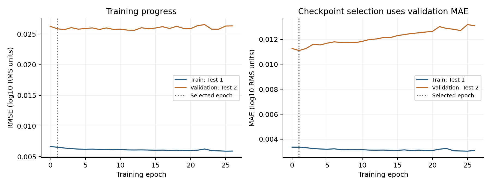
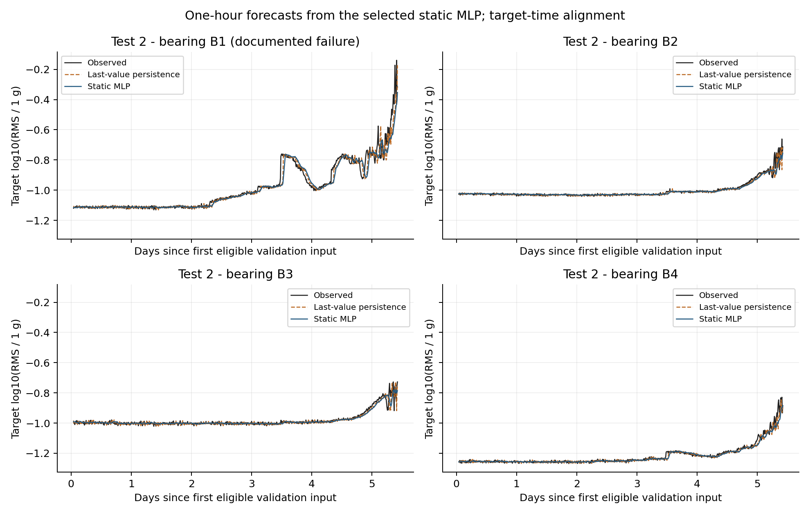

# Static MLP reference experiment

Our model predicts a correction to a six-observation trailing mean of log-RMS.
It has 40 inputs, two 64-unit ReLU layers, and a linear output: 6,849 trainable
parameters. We implemented the forward pass, backpropagation, and Adam in NumPy.

We train on Test 1 with shuffled batches of 64, learning rate 0.001, and seed 42.
We divide residual targets by their training-set standard deviation and select
the checkpoint using Test 2 MAE. Test 2 supplies no gradients. The limit is 200
epochs with patience 25. We log epoch 0 but select only among trained epochs.

The reference run selected epoch 1 and stopped at epoch 26. The training and
validation curves are shown below. Deteriorating validation error alone is not
evidence of plasticity loss.

The README gives commands that write outputs into `runs/local/`. Saved outputs
include the selected model, Adam moments, update count, feature order, residual
scale, per-example predictions, history, and per-bearing metrics. Model files and
per-example predictions are ignored by Git and regenerated by running the script.
Only compact reference summaries and plots are committed.

Before the continual comparison, we need to choose whether to keep the saved
Adam state initially and how to handle it after shrink-and-perturb. See
[the protocol](protocol.md).
